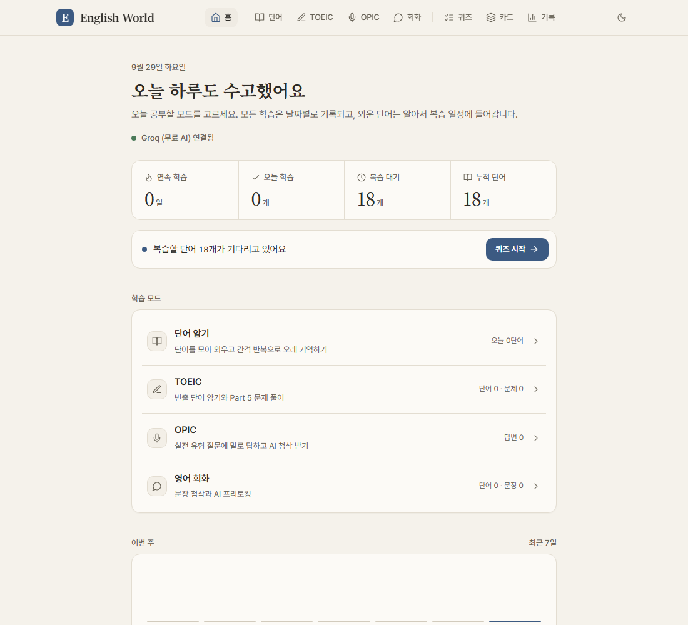
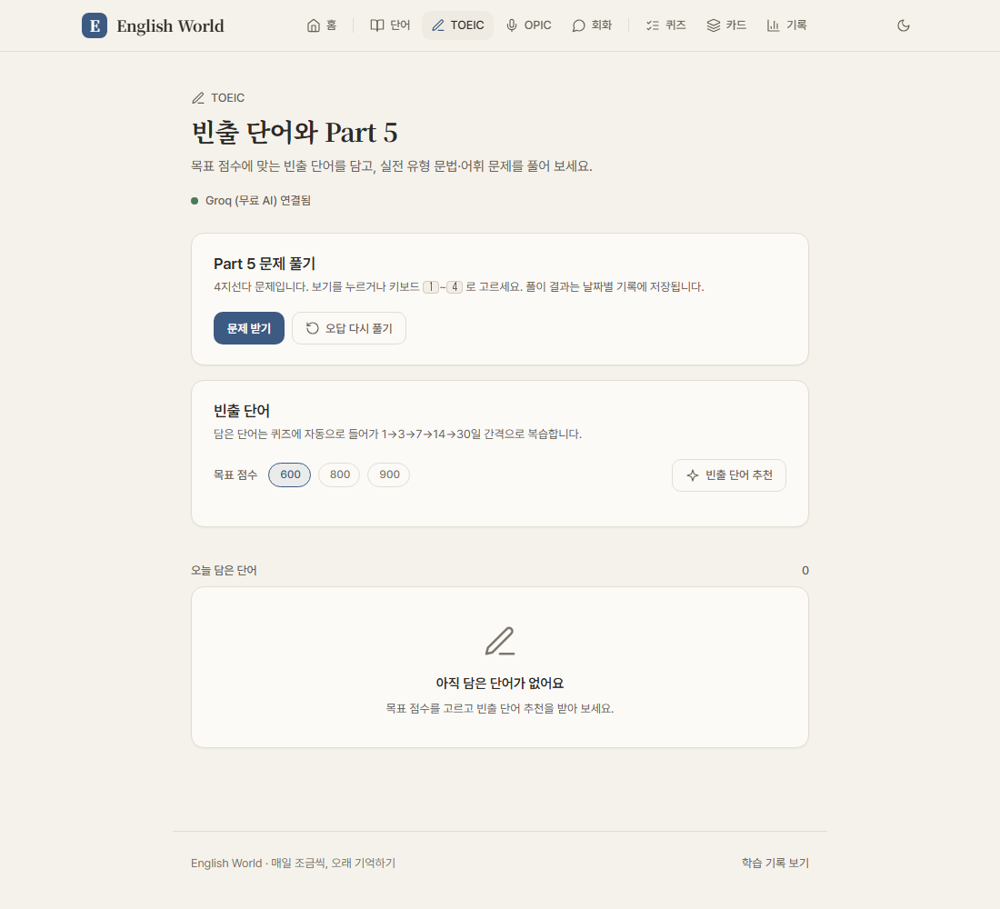
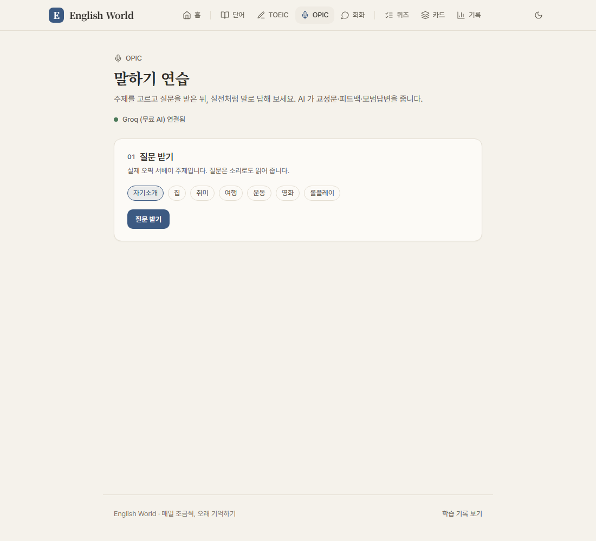
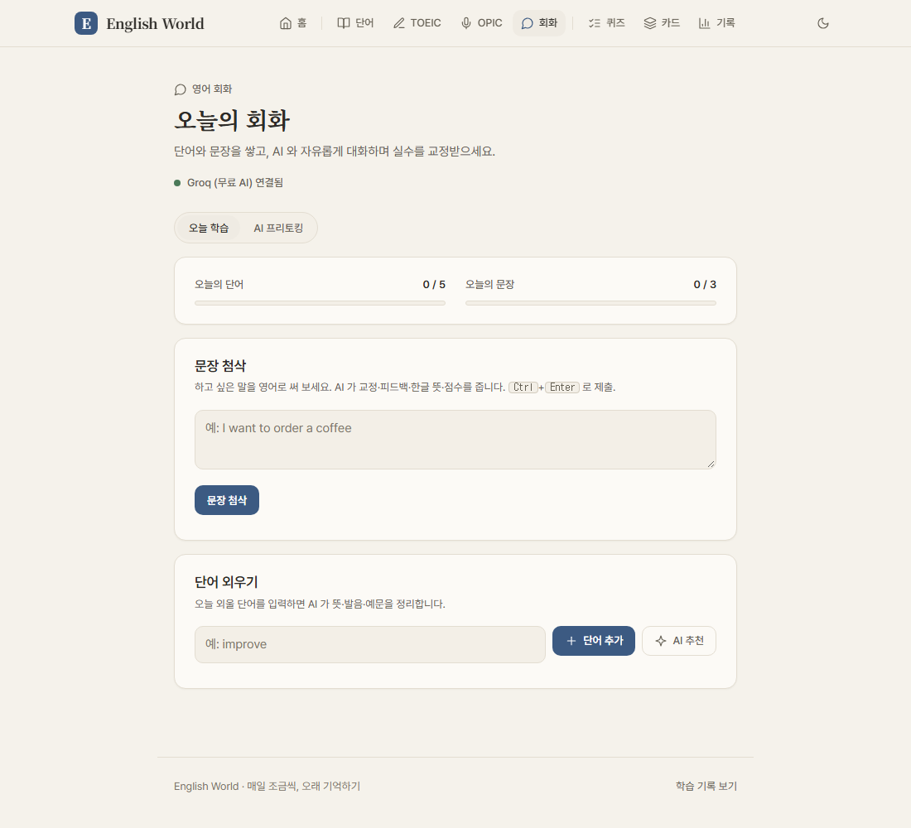
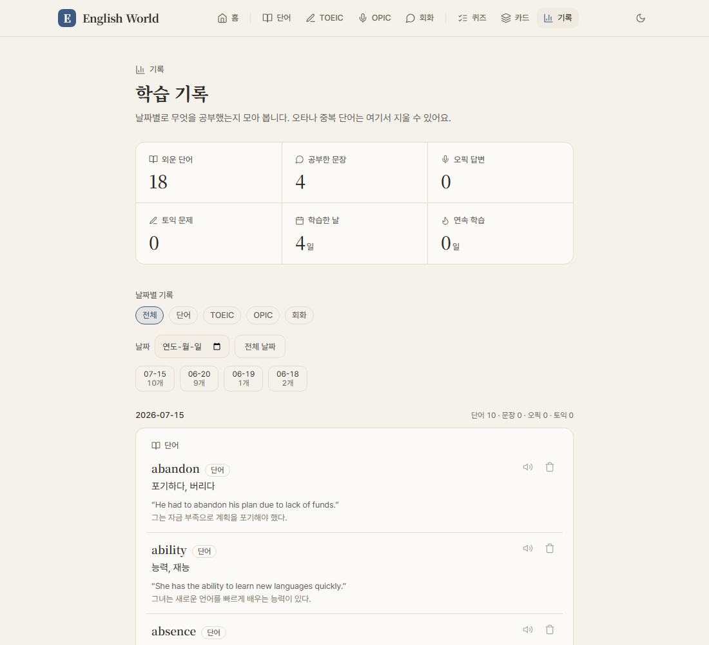
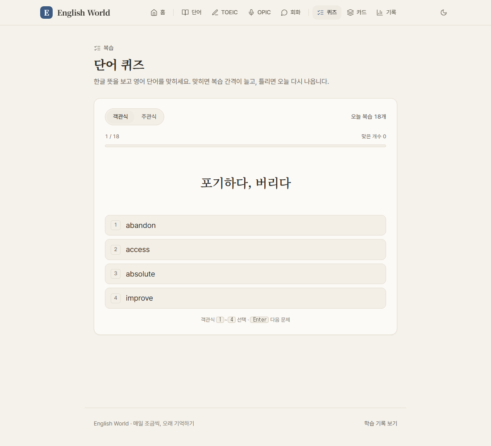

# English World — AI 영어 학습 트래커

토익·오픽을 준비하는 친구들이 각자 계정으로 매일 쓰는 영어 학습 웹앱입니다. 직접 쓴 토익 빈출 어휘 360개 · Part 5 문제 200개(해설 포함) · 오픽 질문 89개를 담았고, 홈에서 "오늘 할 일"을 보여 주며, 단어와 오답은 간격 반복(SM-2)으로 다시 나옵니다.

| 항목 | 내용 |
|---|---|
| 기간 | 2026.06 ~ 현재 |
| 역할 | 개인 프로젝트 (기획 · 개발 전부) |
| 기술 스택 | Python Flask · OpenAI/Groq API · SQLite · HTML/CSS/JS · Web Speech API |
| 디자인 | [DESIGN.md](DESIGN.md) "공책(Notebook)" — 눈이 편한 미색 종이/따뜻한 다크, 잉크 블루 강조색 하나, Pretendard + Noto Serif KR |
| 배포 | Procfile(gunicorn) · Dockerfile 준비됨 — [배포하기](docs/배포.md) |

## 목차

- [스크린샷](#스크린샷)
- [주요 기능](#주요-기능)
- [시작하기](#시작하기)
- [프로젝트 구조](#프로젝트-구조)
- [더 읽을거리](#더-읽을거리)
- [앞으로 개선하고 싶은 것](#앞으로-개선하고-싶은-것)

## 스크린샷

<table>
  <tr>
    <td width="50%" valign="top"><b>홈 — 학습 모드 선택</b><br>모드 카드 + 오늘 학습 요약<br></td>
    <td width="50%" valign="top"><b>TOEIC</b><br>빈출 단어 + Part 5<br></td>
  </tr>
  <tr>
    <td valign="top"><b>OPIC</b><br>질문 → 말하기 → AI 첨삭<br></td>
    <td valign="top"><b>회화</b><br>오늘 학습 + AI 프리토킹<br></td>
  </tr>
  <tr>
    <td valign="top"><b>학습 기록</b><br>날짜별 · 모드별 필터<br></td>
    <td valign="top"><b>단어 퀴즈</b><br>간격 반복(SRS)으로 모든 모드의 단어 통합 복습<br></td>
  </tr>
</table>

## 주요 기능

| 화면 | 할 수 있는 것 |
|---|---|
| 계정 `/signup` `/login` `/account` | 아이디+비밀번호 가입(선택: 초대 코드) · 기록은 사람마다 따로 · 하루 목표(새 단어·Part 5·오픽)와 토익 목표 점수대 설정 |
| 홈 `/` | **오늘 할 일** — 단어 복습 · 새 단어 · Part 5 · 오답 복습 · 오픽 답변을 목표 대비 진행률로 · 연속 학습일 · 약한 유형 |
| TOEIC `/toeic` | **Part 5 문제 은행 200개** — 10개 유형 × 3단계 난이도로 골라 풀기, 안 푼 문제 우선, 모든 문제 한국어 해설 · 틀린 문제는 **오답 복습** 큐로 · **빈출 어휘 360개**(600/800/900점대, 품사·예문·해석)를 하루 목표만큼 담기 |
| 모의고사 `/toeic/test` | Part 5 10/20/30문제를 **시간 제한**(문제당 24초) 안에 풀고 한 번에 채점 · 유형별 결과 · 문제별 해설 |
| OPIC `/opic` | 17개 주제(기본·설문·돌발·롤플레이) **질문 은행 89개** · 질문마다 팁 · 주제별 답변 틀·표현·예시 답변 · 말하기(음성인식)/타이핑 답변 · 첨삭과 분량 피드백 |
| 단어 퀴즈 `/quiz` · 카드 `/review` | **SM-2 간격 반복** — 맞히면 1일 → 3일 → 점점 길게, 틀리면 오늘 다시 · 객관식(같은 품사 보기)/주관식 |
| 기록 `/history` | **약점 분석**(Part 5 유형별 정답률, 단어 퀴즈 정답률, 오픽 주제별 평균) · 모의고사 기록 · 날짜별·모드별 학습 기록 |
| 단어 암기 `/vocab` · 회화 `/talk` | 모르는 단어 직접 추가(AI 정리) · PDF 단어장 · 문장 첨삭 · AI 프리토킹 |

- **발음 듣기** — 단어·문장·정답·AI 답변 옆 스피커 버튼으로 원어민 발음 재생 (브라우저 음성합성, 무료)
- **중복 방지** — 같은 단어는 다시 저장되지 않고 안내가 나옵니다
- **AI 키가 없어도 동작** — 문제·어휘·질문 은행과 복습은 AI 없이 그대로 쓰고, 첨삭만 규칙기반으로 대신합니다. 무료 Groq 키를 넣으면 실제 AI 첨삭으로 바뀝니다 → [무료AI설정.md](docs/무료AI설정.md)
- **콘텐츠는 오리지널** — 시험 기출이나 책을 옮기지 않고 직접 쓴 문제입니다. `python scripts/validate_content.py` 로 형식(정답 하나·보기 중복·필드 누락)을 검사합니다.
- **폰에서도 사용** — 같은 와이파이에서 접속하고, "홈 화면에 추가"로 앱처럼 설치(PWA)
- **단축키** — 퀴즈·Part 5는 `1`~`4` 선택 / `Enter` 다음, 플래시카드는 `Space` 뒤집기 / `←` `→` 이동, 문장 첨삭은 `Ctrl`+`Enter` 제출

## 시작하기

### 사전 요구사항

- Python 3.9 이상 (Docker 이미지는 Python 3.11 기준)
- (선택) AI 키 — `.env.example` 을 `.env` 로 복사해 `GROQ_API_KEY`(무료) 또는 `OPENAI_API_KEY` 하나만 채웁니다. 비워 두면 목업 모드로 동작합니다.

### 가장 쉬운 방법 (Windows)

`시작하기.bat` 을 더블클릭하면 서버가 켜지고 브라우저가 자동으로 열립니다. 콘솔에 표시되는 `http://192.168.x.x:5000` 주소로 같은 와이파이의 폰에서도 접속할 수 있습니다.

### 터미널로 실행

```bash
python3 -m venv .venv && source .venv/bin/activate   # Windows: .venv\Scripts\activate
pip install -r requirements.txt
```

```bash
python app.py
```

브라우저에서 http://127.0.0.1:5000 으로 접속해 가입합니다. **처음 가입한 계정이 기존 학습 기록을 이어받습니다**(`OWNER_USERNAME` 을 정하면 그 아이디가 이어받음). 포트는 `PORT`, 같은 와이파이 공개는 `HOST=0.0.0.0` 으로 바꿉니다. 자세한 단계는 [실행가이드.md](docs/실행가이드.md)에 있습니다.

### PDF 단어장 적재 (선택)

표 형식(No/영단어/뜻/예문) PDF를 내 단어장에 넣습니다. `pdfplumber` 가 필요합니다.

```bash
pip install pdfplumber
```

```bash
python scripts/import_wordbook.py "내단어장.pdf"
```

### 테스트

```bash
python -m pytest -q
```

AI 키 없이 목업 모드 + 임시 DB 로 계정·사용자별 분리·콘텐츠 형식·간격 반복·모의고사·전체 API 를 검증합니다.

### 배포

`Procfile`(gunicorn)과 `Dockerfile` 이 준비되어 있습니다. 공개 서버라면 `SECRET_KEY`·`INVITE_CODE`(친구에게만 가입 허용)를 설정하고, `DB_PATH` 를 영구 디스크로 지정하세요. 환경변수 목록과 플랫폼별 방법은 [docs/배포.md](docs/배포.md)에 있습니다.

## 프로젝트 구조

```text
AI-English-Learning-Program/
├─ app.py             Flask 서버 (계정 · 페이지 라우트 + API)
├─ db.py              SQLite 저장/조회/통계 · 사용자별 분리 · SM-2 복습 · 오늘 할 일 (데이터 계층)
├─ content.py         학습 콘텐츠 읽기
├─ data/              toeic_vocab.json · toeic_part5.json · opic_bank.json (직접 작성한 문제)
├─ ai_feedback.py     AI 기능 (첨삭/단어/토익 문제/오픽 질문·첨삭) + 목업
├─ templates/         base(공통 레이아웃) · _macros · _icons(SVG) + 화면별 템플릿
├─ static/            style.css · common.js(공통 유틸) + 페이지별 JS · PWA manifest
├─ scripts/           import_wordbook.py (PDF 단어장 적재) · validate_content.py (콘텐츠 형식 검사)
├─ tests/             pytest (DB / API 검증)
├─ docs/              실행가이드 · 무료AI설정 · 배포 · 프로젝트설명 · 기술 선택(text.MD) · API/DB · 스크린샷
├─ DESIGN.md          디자인 시스템 (색·글꼴·컴포넌트 규칙)
├─ Procfile · Dockerfile  배포 설정
└─ 시작하기.bat        Windows 더블클릭 실행
```

## 더 읽을거리

- [docs/프로젝트설명.md](docs/프로젝트설명.md) — 프로젝트 구조, 동작 원리, 학습 루틴
- [docs/text.MD](docs/text.MD) — 기술 선택 이유
- [docs/실행가이드.md](docs/실행가이드.md) — 처음 실행하는 사람을 위한 단계별 안내
- [docs/무료AI설정.md](docs/무료AI설정.md) — 무료 Groq 키 설정
- [docs/배포.md](docs/배포.md) — 환경변수, Render/Railway, Docker 배포
- [docs/API_및_DB.md](docs/API_및_DB.md) — 페이지·API 목록과 DB 스키마
- [docs/트러블슈팅.md](docs/트러블슈팅.md) — "학습 기록이 가끔 사라지던 문제" 해결 기록 (commit 누락, WAL 모드, 에러 처리)
- [DESIGN.md](DESIGN.md) · [DESIGN-GUIDE.md](DESIGN-GUIDE.md) — 디자인 시스템

## 앞으로 개선하고 싶은 것

- ~~단어 퀴즈(객관식) 채점 모드~~ — 완료 (2026-07)
- ~~토익 오답 다시 풀기~~ — 완료 (2026-07)
- ~~틀린 문법 유형별 통계 · 사용자별 계정~~ — 완료 (2026-11)
- Part 6·7(장문) 문제, 듣기(LC) 연습
- 학습 알림
- 오픽 답변도 간격 반복 복습에 편입
